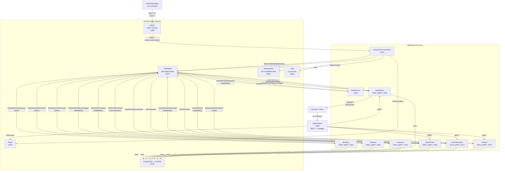
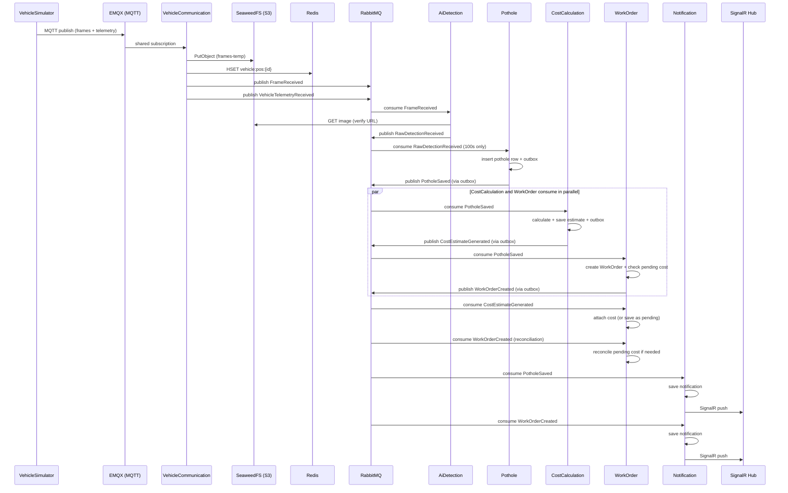
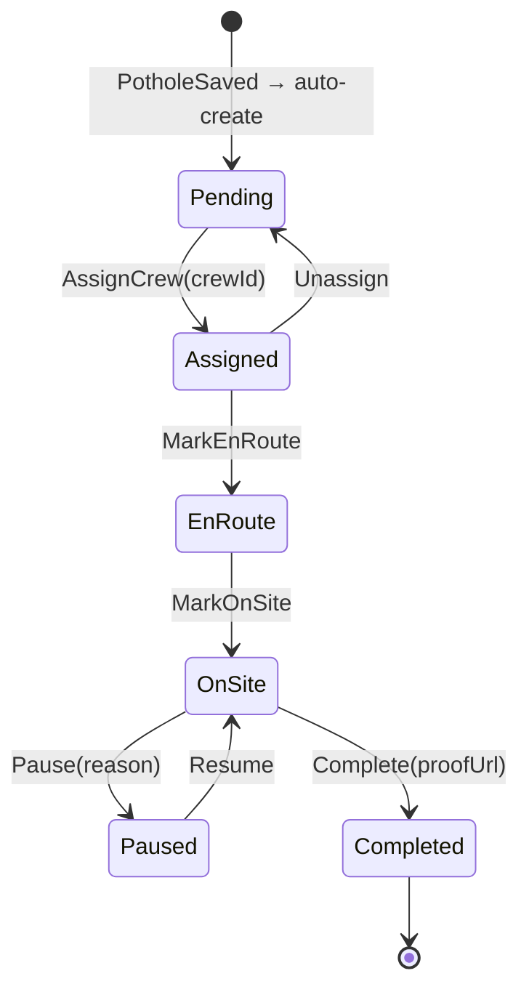

# SmartCity Monitoring — دليل النظام الكامل

> الملف ده مبني على الكود اللي على `main` بتاريخ 2026-10-06.
> كل اسم ملف، كلاس، method مذكور هنا موجود فعلاً في الكود.

---

## 1. الفكرة في دقيقة

تخيل إن البلدية عندها عربيات بتلف الشوارع كل يوم. كل عربية عليها كاميرا بتصور الشارع.

النظام ده بيعمل كده:
كاميرا العربية بتاخد صورة → الصورة بتتبعت للسيرفر → AI بيبص عليها ويقول "لقيت حفرة" → الحفرة بتتسجل في الداتابيز → النظام بيحسب تكلفة الإصلاح → بيفتح أمر عمل (work order) → بيبعت إشعار للمسؤولين → المسؤول بيعيّن طاقم ويتابع الشغل لحد ما يتصلّح.

**التشبيه:** النظام زي "دورية تفتيش" — العربيات عيونك في الشارع، والـAI عقلك اللي بيفهم الصور، والباقي هو الإدارة اللي بتوزّع الشغل وتتابعه.

الكود دلوقتي **walking skeleton**: كل الخدمات موجودة والسلسلة كلها شغالة من أول الصورة لآخر الإشعار، بس أغلب اللوجيك لسه stubs (تمثيل مبسط). الـAI مثلاً بيرمي نرد بدل ما يحلل صورة فعلاً.

---

## 2. خريطة النظام



**ملخص الأسهم:**
| من | لـ | البروتوكول | ليه |
|---|---|---|---|
| Simulator → EMQX | MQTT v5 QoS 1 | بيبعت صور و telemetry |
| EMQX → VehicleCommunication | MQTT shared subscription | بيستقبل الرسايل |
| Service → Service | RabbitMQ (MassTransit events) | كل الـevents بين الخدمات |
| Gateway → Service | gRPC | الـqueries والـcommands |
| Browser → Gateway | HTTP/REST | الـAPI اللي الـclient بيستخدمها |
| Notification → Browser | SignalR (WebSocket) | إشعارات real-time |

---

## 3. رحلة صورة واحدة

هنتتبع صورة واحدة من أول ما المحاكي بيبعتها لحد ما الإشعار بيوصل.

### الخطوة 1: المحاكي بيبعت الصورة عبر MQTT

**الخدمة:** VehicleSimulator (مش خدمة، ده console app)  
**الملف:** `tools/VehicleSimulator/Program.cs`  

```csharp
// tools/VehicleSimulator/Program.cs — بيبني MQTT message
var frameMsg = new MqttApplicationMessageBuilder()
    .WithTopic($"vehicles/{vehicleId}/frames")
    .WithPayload(tinyJpeg)                          // bytes الصورة
    .WithQualityOfServiceLevel(MqttQualityOfServiceLevel.AtLeastOnce)
    .WithUserProperty("frameId", frameId.ToString())
    .WithUserProperty("lat", pos.lat.ToString("F6"))
    .WithUserProperty("lon", pos.lon.ToString("F6"))
    .Build();
await client.PublishAsync(frameMsg, cts.Token);
```

- الصورة نفسها بتروح payload الرسالة (image bytes).
- الـmetadata (frameId, lat, lon, capturedAt, etc.) بتروح في MQTT v5 **user properties** — مش في الـJSON.
- Topic pattern: `vehicles/{vehicleId}/frames`
- المحاكي كمان بيبعت **telemetry** على `vehicles/{vehicleId}/telemetry` كـJSON.
- الـframeId بيتطبع في الـconsole عشان تقدر تتبّعه.

**الرسالة:** مفيش رسالة RabbitMQ هنا لسه. الرسالة MQTT بس.

**البيانات بتتحفظ فين:** مفيش — المحاكي مبيحفظش حاجة.

---

### الخطوة 2: VehicleCommunication بيستقبل الصورة، يرفعها S3، وينشر FrameReceived

**الخدمة:** VehicleCommunication  
**الملف والكلاس:** `src/Services/VehicleCommunication/SmartCity.VehicleCommunication/Mqtt/MqttSubscriberService.cs` — كلاس `MqttSubscriberService`  
**الـmethod:** `HandleFrame`

```csharp
// MqttSubscriberService.cs:HandleFrame — بيرفع الصورة ويطلّع event
var s3Key = $"{vehicleId}/{dateKey}/{frameId}.jpg";
await s3.PutObjectAsync(new PutObjectRequest
{
    BucketName = "frames-temp",
    Key = s3Key,
    InputStream = stream,
});
var imageUrl = $"{s3Options.PublicBaseUrl}/frames-temp/{s3Key}";

var frameReceived = new FrameReceived
{
    FrameId = frameId,
    CorrelationId = frameId,     // ← ده بداية السلسلة: CorrelationId = FrameId
    VehicleId = vehicleId,
    ImageUrl = imageUrl,
    Location = new GeoLocation { Latitude = lat, Longitude = lon },
};
await publishEndpoint.PublishEvent(frameReceived);
```

- أول حاجة: validation — الـvehicleId لازم يبدأ بـ`MUN-VEH-` والإحداثيات لازم جوا Konya bounding box (lat 37.6–38.2, lon 32.2–32.8). لو مش صح → log warning ويتجاهلها.
- بيرفع الصورة لـ`frames-temp` bucket في SeaweedFS (S3-compatible).
- بينشر `FrameReceived` على RabbitMQ عبر MassTransit. **هنا بيبدأ الـCorrelationId = FrameId** — ده الخيط اللي هيربط كل حاجة ببعض.
- كمان الـtelemetry بتتكاتش في **Redis** hash: `vehicle:pos:{vehicleId}` بـTTL 60 ثانية.

**الرسالة اللي بتطلع — `FrameReceived`:**
```json
{
  "EventId": "a1000000-...-000001",
  "CorrelationId": "3f2a0000-...-000001",
  "FrameId": "3f2a0000-...-000001",
  "VehicleId": "MUN-VEH-042",
  "CapturedAt": "2026-10-01T08:15:01.900Z",
  "Location": { "Latitude": 37.8601, "Longitude": 32.4721 },
  "SpeedKmh": 32.5,
  "ImageUrl": "http://localhost:9000/frames-temp/MUN-VEH-042/2026-10-01/3f2a0000-...-000001.jpg"
}
```

**البيانات بتتحفظ فين:**
- الصورة → `frames-temp` bucket في SeaweedFS
- الموقع → Redis hash `vehicle:pos:MUN-VEH-042`

---

### الخطوة 3: AiDetection بيحلل الصورة (stub) وينشر RawDetectionReceived

**الخدمة:** AiDetection  
**الملف والكلاس:** `src/Services/AiDetection/SmartCity.AiDetection/Consumers/FrameReceivedConsumer.cs` — كلاس `FrameReceivedConsumer`  
**الـmethod:** `Consume`

```csharp
// FrameReceivedConsumer.cs — بينزل الصورة ويعمل fake inference
var response = await _httpClient.GetAsync(downloadUrl);    // بيثبت إن URL الصورة شغال
var imageBytes = await response.Content.ReadAsByteArrayAsync();

// SKELETON: بيرمي نرد بدل ما يحلل فعلاً
if (!forceDetection && rng.NextDouble() > detectionRate)
    return;                                                // مفيش detection → مبينشرش حاجة

var detection = new RawDetectionReceived
{
    DetectionId = Guid.NewGuid(),
    CorrelationId = frame.CorrelationId,  // ← بينسخ الـCorrelationId من FrameReceived
    FrameId = frame.FrameId,
    Type = type,                          // e.g. Pothole, RoadCrack
    Confidence = 0.6 + rng.NextDouble() * 0.38,
    ModelName = "fake-ai",
};
await context.PublishFollowUp(detection);
```

- بينزّل الصورة من S3 عبر HTTP (بيثبت إن الـURL اللي في الـevent شغال).
- **SKELETON:** مش بيحلل فعلاً — بيستخدم `FakeAi:DetectionRate` (default 2%) أو `FakeAi:ForceDetection=true` للـtesting.
- الـ`DetectionType` بيحدد مين هيستقبل الرسالة:
  - 100s (Pothole, RoadCrack, SurfaceDamage) → **Pothole** service
  - 200s (TrafficLight, TrafficSign, ...) → **Inventory** service
  - 300s (CommercialSign, Banner, ...) → **Violation** service
  - 400s (Scaffolding, ConstructionSite, ...) → **Building** service
- **مهم:** `PublishFollowUp` بيتأكد إن الـ`CorrelationId` متنسخ صح والـ`SourceDetectionId` مش فاضي. لو مش كده بيرمي exception.

**الرسالة اللي بتطلع — `RawDetectionReceived`:**
```json
{
  "CorrelationId": "3f2a0000-...-000001",
  "DetectionId": "d0000000-...-000001",
  "FrameId": "3f2a0000-...-000001",
  "Type": "Pothole",
  "Confidence": 0.91,
  "ModelName": "fake-ai",
  "ModelVersion": "0.1.0-skeleton",
  "ImageUrl": "http://localhost:9000/frames-temp/MUN-VEH-042/2026-10-01/3f2a0000-...-000001.jpg",
  "Metadata": { "estimated_depth_cm": "6" }
}
```

**البيانات بتتحفظ فين:** مفيش — AiDetection stateless.

---

### الخطوة 4: Pothole بيسجل الحفرة وينشر PotholeSaved

**الخدمة:** Pothole  
**الملف والكلاس:** `src/Services/Pothole/SmartCity.Pothole.Api/Consumers/RawDetectionReceivedConsumer.cs` — كلاس `RawDetectionReceivedConsumer`  
**الـmethod:** `Consume`

```csharp
// Pothole RawDetectionReceivedConsumer.cs
if (!msg.Type.IsRoadDamage()) return;   // بيفلتر: 100s بس

var severity = ClassifySeverity(msg.Metadata);
// SKELETON: depth < 4 → Low, 4–7 → Medium, 7–10 → High, > 10 → Critical
var district = ClassifyDistrict(msg.Location.Latitude, msg.Location.Longitude);
// SKELETON: bounding boxes مش PostGIS polygons

var pothole = new PotholeRecord { ... };
_db.Potholes.Add(pothole);

var saved = new PotholeSaved
{
    CorrelationId = msg.CorrelationId,
    SourceDetectionId = msg.DetectionId,
    PotholeId = pothole.Id,
    IsNewPothole = true,
    Severity = severity,
};
await context.PublishFollowUp(saved);   // بتروح في نفس الـtransaction مع الـSaveChanges
await _db.SaveChangesAsync();           // outbox بتبعت الـevent بعد ما الـDB يـcommit
```

- بيفلتر: لو الـType مش road damage (100s) → بيرجع من غير ما يعمل حاجة.
- بيحسب الـseverity من `estimated_depth_cm` في الـMetadata.
- بيحسب الـdistrict من الإحداثيات (SKELETON: bounding boxes بسيطة).
- **SKELETON:** مفيش clustering — كل detection بتعمل pothole جديد. النسخة الحقيقية هتستخدم `ST_DWithin` 3–5 متر.
- الـevent بتتنشر عبر الـ**transactional outbox** — يعني الـevent بتتحفظ في الداتابيز في نفس الـtransaction مع الـpothole row، وبعدين MassTransit بتبعتها لـRabbitMQ.

**الرسالة اللي بتطلع — `PotholeSaved`:**
```json
{
  "CorrelationId": "3f2a0000-...-000001",
  "SourceDetectionId": "d0000000-...-000001",
  "PotholeId": "b0000000-...-000001",
  "IsNewPothole": true,
  "District": "Meram",
  "DetectionType": "Pothole",
  "Severity": "Medium",
  "Confidence": 0.91,
  "ImageUrls": ["http://localhost:9000/frames-temp/..."]
}
```

**البيانات بتتحفظ فين:** جدول `potholes` في `pothole_db`  
- الموقع بيتحفظ كـ`geography(Point,4326)` عليه GIST index عشان الاستعلامات المكانية.

---

### الخطوة 5: CostCalculation بيحسب التكلفة وينشر CostEstimateGenerated

**الخدمة:** CostCalculation  
**الملف والكلاس:** `src/Services/CostCalculation/SmartCity.CostCalculation.Api/Consumers/PotholeSavedConsumer.cs` — كلاس `PotholeSavedConsumer`  
**الـmethod:** `Consume`

```csharp
// CostCalculation PotholeSavedConsumer.cs
if (!msg.IsNewPothole) return;

// SKELETON: جدول أسعار ثابت بالليرة التركية
var (total, materialCost, laborCost, equipmentCost) = GetCostBySeverity(msg.Severity);
// Low → 1,000 TRY, Medium → 1,800, High → 2,500, Critical → 4,000
// 36% مواد / 48% عمالة / 16% معدات

var estimate = new CostEstimate { TotalEstimatedCost = total, ... };
_db.CostEstimates.Add(estimate);

var generated = new CostEstimateGenerated
{
    CorrelationId = msg.CorrelationId,
    SourceEntityId = msg.PotholeId,
    TotalEstimatedCost = total,
    Materials = new List<MaterialItem> { new() { Name = "Soğuk asfalt", ... } },
};
await context.PublishFollowUp(generated);
await _db.SaveChangesAsync();
```

- بيسمع لـ`PotholeSaved` (بس لما `IsNewPothole = true`).
- **SKELETON:** أسعار ثابتة حسب الـseverity. النسخة الحقيقية هتقرا من كاتالوج أسعار.

**الرسالة اللي بتطلع — `CostEstimateGenerated`:**
```json
{
  "CorrelationId": "3f2a0000-...-000001",
  "EstimateId": "c0000000-...-000001",
  "SourceEntityId": "b0000000-...-000001",
  "SourceEntityType": "RoadDamage",
  "TotalEstimatedCost": 1800.00,
  "MaterialCost": 648.00,
  "LaborCost": 864.00,
  "EquipmentCost": 288.00,
  "Currency": "TRY",
  "Materials": [{ "Name": "Soğuk asfalt", "Quantity": 1.0, "Unit": "m³" }]
}
```

**البيانات بتتحفظ فين:** جدول `cost_estimates` في `costcalc_db`

---

### الخطوة 6: WorkOrder بيفتح أمر عمل

**الخدمة:** WorkOrder  
**الملف والكلاس:** `src/Services/WorkOrder/SmartCity.WorkOrder.Api/Consumers/PotholeSavedConsumer.cs` — كلاس `PotholeSavedConsumer`  
**الـmethod:** `Consume`

```csharp
// WorkOrder PotholeSavedConsumer.cs
if (!msg.IsNewPothole) return;

// idempotent: لو فيه work order بنفس الـSourceEntityId → بيتجاهل
if (await _db.WorkOrders.AnyAsync(w => w.SourceEntityId == msg.PotholeId))
    return;

// بيشوف لو الـcost estimate وصل قبلنا (race condition)
var pending = await _db.PendingCostEstimates
    .FirstOrDefaultAsync(p => p.SourceEntityId == msg.PotholeId);

var wo = WorkOrderAggregate.Create(
    ticketNumber: nextVal,  // "WO-2026-000001" من Postgres sequence
    sourceEntityId: msg.PotholeId,
    priority: MapPriority(msg.Severity),
    estimatedCost: pending?.TotalEstimatedCost,  // لو لقى pending estimate
);
```

**مشكلة الـrace condition:** الـWorkOrder والـCostCalculation بيسمعوا لـ`PotholeSaved` **في نفس الوقت**. يعني ممكن الـcost estimate يوصل قبل ما الـwork order يتعمل. الحل:

1. **`CostEstimateGeneratedConsumer`** (في `src/Services/WorkOrder/SmartCity.WorkOrder.Api/Consumers/CostEstimateGeneratedConsumer.cs`): لو الـwork order موجود → بيلزق التكلفة. لو مش موجود → بيحفظ الـcost في جدول `pending_cost_estimates`.
2. **`PotholeSavedConsumer`**: لما بيعمل الـwork order بيبص لو فيه pending cost estimate ويلزقه.
3. **`WorkOrderCostReconciliationConsumer`** (في `src/Services/WorkOrder/SmartCity.WorkOrder.Api/Consumers/WorkOrderCostReconciliationConsumer.cs`): بيسمع لـ`WorkOrderCreated` — لو الـwork order اتعمل من غير cost، بيبص لو فيه pending ويلزقه. ده بيحل الحالة اللي الاتنين وصلوا في نفس الوقت بس الـoutbox transactions مشفوش بعض.

**الرسالة اللي بتطلع — `WorkOrderCreated`:**
```json
{
  "CorrelationId": "3f2a0000-...-000001",
  "WorkOrderId": "e0000000-...-000001",
  "TicketNumber": "WO-2026-000001",
  "SourceEntityId": "b0000000-...-000001",
  "Category": "RoadRepair",
  "Priority": "Medium",
  "Status": "Pending",
  "Title": "Pothole — Meram",
  "SlaDueAt": "2026-10-06T08:15:03Z"
}
```

**البيانات بتتحفظ فين:** جداول `work_orders`, `work_order_status_history`, `pending_cost_estimates` في `workorder_db`

---

### الخطوة 7: Notification بيبعت إشعارات

**الخدمة:** Notification  
**الملفات والكلاسات:**
- `src/Services/Notification/SmartCity.Notification.Api/Consumers/PotholeSavedConsumer.cs` — إشعار "حفرة جديدة"
- `src/Services/Notification/SmartCity.Notification.Api/Consumers/WorkOrderCreatedConsumer.cs` — إشعار "أمر عمل جديد"
- `src/Services/Notification/SmartCity.Notification.Api/Consumers/WorkOrderStatusChangedConsumer.cs` — إشعار "حالة أمر العمل اتغيرت"

```csharp
// WorkOrderCreatedConsumer.cs
var notification = new NotificationRecord
{
    Title = $"New work order: {msg.TicketNumber}",
    Body = $"{msg.Title} — Priority: {msg.Priority}, District: {msg.District}",
    RelatedEntityId = msg.WorkOrderId,
    Recipient = "dashboard",      // SKELETON: مفيش routing لمستخدمين
};
_db.Notifications.Add(notification);
await _db.SaveChangesAsync();

// SignalR push لكل الـclients المتصلين
await _hub.Clients.All.SendAsync("NotificationReceived", new { ... });
```

- بيسمع لـ3 events: `PotholeSaved`, `WorkOrderCreated`, `WorkOrderStatusChanged`.
- بيحفظ الإشعار في الداتابيز ويبعته عبر **SignalR** لكل الـclients المتصلين.
- **SKELETON:** مفيش SMS/push، مفيش routing لمستخدمين محددين — كل حاجة بتروح لـ`"dashboard"`.

**البيانات بتتحفظ فين:** جدول `notifications` في `notification_db`

---

### الرحلة كاملة — Sequence Diagram



---

## 4. رحلة أمر العمل (Work Order Lifecycle)

أمر العمل بيتعمل أوتوماتيك لما حفرة جديدة تتسجل. بعد كده، المسؤول (officer) بيديره من الـGateway REST API.

### المسار الكامل:

1. **الحفرة بتتسجل** → `PotholeSavedConsumer` بيعمل work order بحالة `Pending`.
2. **المسؤول بيعيّن طاقم:**
   ```
   POST /api/work-orders/{id}/assign
   Headers: Idempotency-Key: abc-123
   Body: { "crewId": "CREW-MERAM-03" }
   ```
   → الحالة بتتغير لـ`Assigned`.

3. **الطاقم في الطريق:**
   ```
   POST /api/work-orders/{id}/en-route
   ```
   → `EnRoute`

4. **الطاقم وصل الموقع:**
   ```
   POST /api/work-orders/{id}/on-site
   ```
   → `OnSite`

5. **الطاقم لازم يوقف (اختياري):**
   ```
   POST /api/work-orders/{id}/pause
   Body: { "reason": "Weather" }
   ```
   → `Paused`

6. **الطاقم بيكمّل (اختياري بعد pause):**
   ```
   POST /api/work-orders/{id}/resume
   ```
   → `OnSite`

7. **الطاقم خلّص الشغل:**
   ```
   POST /api/work-orders/{id}/complete
   Body: { "proofImageUrl": "http://localhost:9000/evidence/proof.jpg" }
   ```
   → `Completed`

كل خطوة بتنشر `WorkOrderStatusChanged` event → الـNotification service بيبعت إشعار.

### State Diagram



**ملاحظات مهمة:**
- كل transition مش مسموح بيرمي `InvalidStateTransitionException` — الـGateway بيرجع HTTP 409.
- كل POST command لازم يبعت `Idempotency-Key` header — من غيره بيرجع 400.
- لو بعت نفس الـ`Idempotency-Key` مرتين، بيرجع نفس الـresponse من غير ما يعمل حاجة.
- الـSLA بيتحسب حسب الـpriority:

| Priority | SLA |
|---|---|
| Critical | 24 ساعة |
| High | 48 ساعة |
| Medium | 5 أيام |
| Routine | 10 أيام |

- رقم التذكرة بيتولد من Postgres sequence: `WO-{yyyy}-{6-digit}` (مثلاً `WO-2026-000001`).

---

## 5. بطاقة لكل خدمة

### VehicleSimulator (console app — مش خدمة)
| | |
|---|---|
| **الهدف** | محاكاة عربيات البلدية — بيبعت صور و telemetry عبر MQTT |
| **بيسمع لإيه** | مفيش — بيبعت بس |
| **بينشر إيه** | MQTT messages على `vehicles/{id}/frames` و `vehicles/{id}/telemetry` |
| **gRPC** | مفيش |
| **DB** | مفيش |
| **أهم ملف** | `tools/VehicleSimulator/Program.cs` |
| **حقيقي ولا SKELETON** | الصورة placeholder JPEG (1x1 pixel). المسارات والإحداثيات حقيقية في قونية |

---

### VehicleCommunication
| | |
|---|---|
| **الهدف** | بوابة الدخول للعربيات — بيستقبل MQTT ويحوّله لـRabbitMQ events |
| **بيسمع لإيه** | MQTT: `$share/vehiclecomm/vehicles/+/frames` و `$share/vehiclecomm/vehicles/+/telemetry` |
| **بينشر إيه** | `FrameReceived`, `VehicleTelemetryReceived` (على RabbitMQ) |
| **gRPC** | مفيش |
| **DB** | مفيش — stateless. بيكاتش الموقع في Redis بس |
| **أهم ملف** | `src/Services/VehicleCommunication/SmartCity.VehicleCommunication/Mqtt/MqttSubscriberService.cs` |
| **حقيقي ولا SKELETON** | الـvalidation حقيقي. الـauth مفيش (SKELETON: الحقيقي هيستخدم mTLS + ACLs) |

---

### AiDetection
| | |
|---|---|
| **الهدف** | بيحلل الصور ويكتشف المشاكل |
| **بيسمع لإيه** | `FrameReceived` |
| **بينشر إيه** | `RawDetectionReceived` (صفر أو أكتر لكل frame) |
| **gRPC** | مفيش |
| **DB** | مفيش — stateless |
| **أهم ملف** | `src/Services/AiDetection/SmartCity.AiDetection/Consumers/FrameReceivedConsumer.cs` |
| **حقيقي ولا SKELETON** | **كله SKELETON** — الـAI مزيف. `FakeAi:ForceDetection` و `FakeAi:DetectionRate` بيتحكموا في السلوك |

---

### Pothole
| | |
|---|---|
| **الهدف** | بيسجل حفر الطرق |
| **بيسمع لإيه** | `RawDetectionReceived` (بيفلتر `IsRoadDamage()` — types 100-199) |
| **بينشر إيه** | `PotholeSaved` |
| **gRPC endpoints** | `RoadDamageQueryService.GetDamageById`, `RoadDamageQueryService.ListDamages` (bbox filter + district + pagination). `GetDamageTimeline` → UNIMPLEMENTED |
| **جداول الـDB** | `potholes` (في `pothole_db`) — location column هو `geography(Point,4326)` عليه GIST index |
| **أهم ملف** | `src/Services/Pothole/SmartCity.Pothole.Api/Consumers/RawDetectionReceivedConsumer.cs` |
| **حقيقي ولا SKELETON** | الـseverity classification حقيقي (من depth). الـdistrict classification (SKELETON: bounding boxes). الـclustering مفيش (SKELETON: كل detection بتعمل pothole جديد) |

---

### Inventory
| | |
|---|---|
| **الهدف** | بيسجل أصول الشارع (إشارات مرور، أعمدة إنارة، إلخ) |
| **بيسمع لإيه** | `RawDetectionReceived` (بيفلتر `IsAsset()` — types 200-299) |
| **بينشر إيه** | مفيش حالياً |
| **gRPC** | مفيش حالياً |
| **جداول الـDB** | outbox tables بس — مفيش domain tables لسه |
| **أهم ملف** | `src/Services/Inventory/SmartCity.Inventory.Api/Consumers/RawDetectionReceivedConsumer.cs` |
| **حقيقي ولا SKELETON** | **كله SKELETON** — بيعمل log بس: `"Received {Type} for detection {DetectionId} — not implemented"` |

---

### Violation
| | |
|---|---|
| **الهدف** | بيسجل مخالفات اللافتات (لافتات غير مرخصة، إلخ) |
| **بيسمع لإيه** | `RawDetectionReceived` (بيفلتر `IsViolation()` — types 300-399) |
| **بينشر إيه** | مفيش حالياً |
| **gRPC** | مفيش حالياً |
| **جداول الـDB** | outbox tables بس |
| **أهم ملف** | `src/Services/Violation/SmartCity.Violation.Api/Consumers/RawDetectionReceivedConsumer.cs` |
| **حقيقي ولا SKELETON** | **كله SKELETON** — بيعمل log بس |

---

### Building
| | |
|---|---|
| **الهدف** | بيسجل مشاكل البناء (سقالات، مواقع بناء مخالفة، إلخ) |
| **بيسمع لإيه** | `RawDetectionReceived` (بيفلتر `IsBuilding()` — types 400-499) |
| **بينشر إيه** | مفيش حالياً |
| **gRPC** | مفيش حالياً |
| **جداول الـDB** | outbox tables بس |
| **أهم ملف** | `src/Services/Building/SmartCity.Building.Api/Consumers/RawDetectionReceivedConsumer.cs` |
| **حقيقي ولا SKELETON** | **كله SKELETON** — بيعمل log بس |

---

### CostCalculation
| | |
|---|---|
| **الهدف** | بيحسب تكلفة الإصلاح |
| **بيسمع لإيه** | `PotholeSaved` (IsNewPothole only) |
| **بينشر إيه** | `CostEstimateGenerated` |
| **gRPC endpoints** | `CostQueryService.GetEstimateForEntity`, `CostQueryService.ListEstimates` |
| **جداول الـDB** | `cost_estimates` (في `costcalc_db`) |
| **أهم ملف** | `src/Services/CostCalculation/SmartCity.CostCalculation.Api/Consumers/PotholeSavedConsumer.cs` |
| **حقيقي ولا SKELETON** | **الأسعار SKELETON** — جدول ثابت: Low 1,000 / Medium 1,800 / High 2,500 / Critical 4,000 TRY. النسخة الحقيقية هتقرا من كاتالوج |

---

### WorkOrder
| | |
|---|---|
| **الهدف** | بيدير أوامر العمل — الـaggregate root الوحيد في النظام (DDD) |
| **بيسمع لإيه** | `PotholeSaved`, `CostEstimateGenerated`, `WorkOrderCreated` (reconciliation) |
| **بينشر إيه** | `WorkOrderCreated`, `WorkOrderStatusChanged` |
| **gRPC endpoints** | **Query:** `GetWorkOrderById`, `ListWorkOrders`. **Command:** `AssignCrew`, `MarkEnRoute`, `MarkOnSite`, `PauseWork`, `ResumeWork`, `SubmitCompletionProof`. `ListMyWorkOrders`, `CreateWorkOrder`, `ReassignWorkOrder`, `ChangePriority`, `RejectResolution`, `LogWorkDetails` → UNIMPLEMENTED |
| **جداول الـDB** | `work_orders`, `work_order_status_history`, `pending_cost_estimates`, `processed_idempotency_keys` (في `workorder_db`) |
| **أهم ملفات** | `src/Services/WorkOrder/SmartCity.WorkOrder.Domain/WorkOrderAggregate.cs` (الـDDD aggregate)، `src/Services/WorkOrder/SmartCity.WorkOrder.Api/Consumers/PotholeSavedConsumer.cs` |
| **حقيقي ولا SKELETON** | الـstate machine والـidempotency **حقيقيين**. الـstub consumers لـ`AssetAddedOrUpdated`/`ViolationSaved`/`ConstructionAnomalyDetected` مش موجودين أصلاً في الكود (ممكن يتزادوا بعدين) |

---

### Notification
| | |
|---|---|
| **الهدف** | بيبعت إشعارات |
| **بيسمع لإيه** | `PotholeSaved`, `WorkOrderCreated`, `WorkOrderStatusChanged` |
| **بينشر إيه** | مفيش events — بيبعت عبر SignalR |
| **gRPC endpoints** | `NotificationQueryService.ListMyNotifications` |
| **جداول الـDB** | `notifications` (في `notification_db`) |
| **أهم ملف** | `src/Services/Notification/SmartCity.Notification.Api/Consumers/WorkOrderCreatedConsumer.cs` |
| **حقيقي ولا SKELETON** | **الـrouting SKELETON** — كل الإشعارات بتروح لـ`"dashboard"`. مفيش SMS/push. الـSignalR hub فاضي (`NotificationHub` ← class فاضي). النسخة الحقيقية هتوزع على مستخدمين حسب الـdistrict/role |

---

### ApiGateway
| | |
|---|---|
| **الهدف** | الـREST API الوحيدة اللي الـclient بيكلمها — بتحوّل HTTP لـgRPC |
| **بيسمع لإيه** | HTTP requests من الـbrowser |
| **بينشر إيه** | مفيش RabbitMQ events |
| **REST endpoints** | `GET /api/work-orders`, `GET /api/work-orders/{id}`, `POST .../assign`, `POST .../en-route`, `POST .../on-site`, `POST .../pause`, `POST .../resume`, `POST .../complete`, `GET /api/potholes/{id}`, `GET /api/potholes?bbox=`, `GET /api/vehicles/live`, `GET /api/estimates/by-entity/{entityId}` |
| **DB** | مفيش — بيقرا الـlive positions من Redis بس |
| **أهم ملف** | `src/Gateway/SmartCity.ApiGateway/Program.cs` |
| **حقيقي ولا SKELETON** | الـresilience (retry + circuit breaker) **حقيقي**. الـauth **SKELETON** — مفيش JWT، بيقرا `X-User-Id` header (default `"dev-officer"`). الـSwagger شغال في Development mode |

---

## 6. العدّة المشتركة (BuildingBlocks)

كل الخدمات بتستخدم `src/BuildingBlocks/SmartCity.BuildingBlocks/`. الحاجات دي بتتعمل مرة واحدة ومحدش بيفكر فيها تاني.

### Transactional Outbox + Inbox

**ملف:** `src/BuildingBlocks/SmartCity.BuildingBlocks/Messaging/OutboxExtensions.cs`

**ليه موجودة:**
لما الـservice بتحفظ row في الداتابيز وبتنشر event على RabbitMQ، دي عمليتين مختلفتين. لو الداتابيز حفظت بس RabbitMQ وقعت، بتفضل داتا في الـDB من غير event. الـoutbox بيحل ده: الـevent بتتحفظ **في نفس الـtransaction** مع الداتا، وبعد كده MassTransit بتقرا الـevents من الداتابيز وتبعتها لـRabbitMQ.

**إيه اللي بيبوظ من غيرها:**
- ممكن الحفرة تتسجل بس الـwork order ما يتعملش.
- الـevent ممكن تتبعت بدون ما الداتا تتحفظ فعلاً (phantom event).

**إزاي بنستخدمها:**
```csharp
// في Program.cs
x.AddSmartCityOutbox<PotholeDbContext>();

// في DbContext.OnModelCreating
modelBuilder.AddSmartCityOutboxEntities();
```

الـ**Inbox** هو الناحية التانية: بيحفظ `MessageId` بتاع كل رسالة اتعالجت، فلو RabbitMQ بعتها تاني (at-least-once) الـconsumer بيتجاهل الـduplicate.

---

### Retries و DLQ (Dead Letter Queue)

**ملف:** `src/BuildingBlocks/SmartCity.BuildingBlocks/Messaging/BusExtensions.cs`

**ليه موجودة:**
الرسالة ممكن تفشل لسبب مؤقت (الداتابيز بطيئة لحظة). الـretry بيحاول تاني قبل ما يستسلم.

**إيه اللي بيبوظ من غيرها:**
- أي خطأ مؤقت بيضيّع الرسالة.
- من غير DLQ الرسايل الفاشلة بتتكرر للأبد وتبلك الـqueue.

**التعريف:**
```csharp
endpoint.UseMessageRetry(r => r.Intervals(
    TimeSpan.FromSeconds(1), TimeSpan.FromSeconds(2), TimeSpan.FromSeconds(4)));
```
لو فشلت بعد 3 محاولات (1s, 2s, 4s) → الرسالة بتروح لـ`_error` queue (الـDLQ بتاعنا). بتقدر تشوفها في RabbitMQ UI.

---

### CorrelationId

**ملف:** `src/BuildingBlocks/SmartCity.BuildingBlocks/Messaging/CorrelationIdLogFilter.cs`

**ليه موجود:**
كل event في النظام بتشيل `CorrelationId` = الـ`FrameId` الأصلي. ده الخيط اللي بيربط الصورة بالحفرة بالتكلفة بأمر العمل بالإشعار.

**إيه اللي بيبوظ من غيره:**
- مش هتقدر تتبّع رحلة صورة واحدة. لو حاجة بوظت، مش هتعرف فين.

**إزاي شغال:**
الـ`CorrelationIdLogFilter<T>` هو MassTransit consume filter. كل ما consumer بيعالج رسالة، الـfilter بيحط الـ`CorrelationId` في Serilog LogContext. بكده كل log line جوا الـconsumer بتشيل الـ`CorrelationId` أوتوماتيك.

في Seq بتكتب:
```
CorrelationId = '3f2a0000-0000-4000-8000-000000000001'
```
وبتشوف كل حاجة حصلت لصورة واحدة من أول الاستقبال لآخر الإشعار.

---

### PublishFollowUp و PublishEvent

**ملف:** `src/BuildingBlocks/SmartCity.BuildingBlocks/Messaging/PublishExtensions.cs`

**ليه موجودين:**

- `PublishFollowUp`: لما consumer بيستقبل event وبينشر event تانية. بيتأكد إن الـ`CorrelationId` متنسخ صح والـ`SourceDetectionId` موجود. كمان بيعمل `MessageId = EventId` — ده اللي الـinbox بيستخدمه يـdeduplicate بيه.
- `PublishEvent`: لما خدمة بتنشر event من غير consumed message (زي VehicleCommunication اللي بتنشر `FrameReceived` مباشرة).

**إيه اللي بيبوظ من غيرهم:**
- ممكن حد ينسى ينسخ الـ`CorrelationId` والـtrace ينقطع.
- من غير `MessageId = EventId` الـinbox مش هيقدر يـdeduplicate.

---

### Health Checks

**ملف:** `src/BuildingBlocks/SmartCity.BuildingBlocks/Hosting/HealthCheckExtensions.cs`

**ليه موجودة:**
- `/health/live` → الـprocess شغال ولا لا (مفيش checks — لو الـendpoint رد يبقى شغال).
- `/health/ready` → الـservice جاهز يشتغل (بيتشيك الداتابيز + RabbitMQ).

**إيه اللي بيبوظ من غيرها:**
- Docker/Kubernetes مش هيعرف لو الـservice مش جاهز وهيبعتله traffic قبل ما يكون جاهز.
- لو الداتابيز وقعت، الـservice هيفضل يستقبل requests ويفشل.

---

### Idempotency-Key

**ملف:** `src/Services/WorkOrder/SmartCity.WorkOrder.Api/Grpc/WorkOrderCommandGrpcService.cs` — method `LoadAndCheckIdempotency`  
**جدول:** `processed_idempotency_keys` في `workorder_db`

**ليه موجود:**
الـclient ممكن يبعت نفس الـrequest مرتين (network retry، المستخدم ضغط مرتين). الـidempotency key بيضمن إن العملية تحصل مرة واحدة بس.

**إيه اللي بيبوظ من غيره:**
- الطاقم ممكن يتعيّن مرتين على نفس أمر العمل.
- ممكن يتم الانتقال لحالة ويتم مرة تانية.

**إزاي شغال:**
1. كل POST request لازم يبعت `Idempotency-Key` header.
2. الـGateway بيبعت الـkey مع الـgRPC `CommandMetadata`.
3. الـWorkOrder بيشوف: لو الـkey موجود في `processed_idempotency_keys` → بيرجع الـresponse المحفوظ.
4. لو جديد → بينفذ العملية ويحفظ الـkey والـresponse.

---

## 7. الفولدرات

```
smartcity-skeleton/
├── CLAUDE.md                          # تعليمات Claude Code (قواعد النظام والمنافذ)
├── docker-compose.yml                 # بنية تحتية + application services (profile: apps)
├── SmartCity.sln                      # الـsolution file
│
├── docs/
│   ├── BUILD-PLAN.md                  # خطة البناء milestone بـmilestone
│   ├── design/
│   │   ├── smartcity-design-record.md # التصميم التفصيلي (L2) — المرجع الأساسي
│   │   └── architecture-decisions.md  # قرارات معمارية
│   └── learning/
│       └── SYSTEM-GUIDE.md            # ← انت هنا
│
├── infra/
│   ├── postgres/init/
│   │   └── 01-create-databases.sql    # بيعمل 7 databases + 7 users + PostGIS
│   └── s3/
│       ├── s3.json                    # SeaweedFS S3 credentials (dev/dev)
│       └── init-buckets.sh            # بيعمل buckets: frames-temp, frames-permanent, evidence
│
├── src/
│   ├── SmartCity.Contracts/           # الـevents والـenums والـprotos — مشترك بين كل الخدمات
│   │   ├── Common/                    # GeoLocation, Dimensions
│   │   ├── Enums/                     # DetectionType, WorkOrderStatus, District, ...
│   │   ├── Events/
│   │   │   ├── IntegrationEvent.cs    # الـbase class لكل event
│   │   │   ├── Ingestion/             # FrameReceived, RawDetectionReceived, VehicleTelemetryReceived
│   │   │   ├── Detection/             # PotholeSaved, ViolationSaved, AssetAddedOrUpdated, ...
│   │   │   └── Business/              # CostEstimateGenerated, WorkOrderCreated, WorkOrderStatusChanged
│   │   ├── MockMessages/
│   │   │   └── mock-events.json       # مثال حقيقي لكل event في الـtrace كله
│   │   └── Protos/                    # gRPC proto files (queries, commands, enums, common)
│   │
│   ├── SmartCity.Contracts.Grpc/      # الكود الـgenerated من الـprotos
│   │
│   ├── BuildingBlocks/
│   │   └── SmartCity.BuildingBlocks/
│   │       ├── Hosting/               # KestrelExtensions (2 ports), HealthCheckExtensions
│   │       ├── Logging/               # LoggingExtensions (Serilog → console + Seq)
│   │       ├── Messaging/             # BusExtensions, OutboxExtensions, PublishExtensions, CorrelationIdLogFilter
│   │       └── Storage/               # BlobStorageExtensions (S3), S3Options
│   │
│   ├── Gateway/
│   │   └── SmartCity.ApiGateway/      # REST → gRPC proxy + Swagger + Redis (live vehicles)
│   │
│   └── Services/
│       ├── VehicleCommunication/      # MQTT → S3 + RabbitMQ (stateless)
│       ├── AiDetection/               # FrameReceived → RawDetectionReceived (stateless, fake AI)
│       ├── Pothole/                   # RawDetectionReceived → PotholeSaved (PostGIS)
│       ├── Inventory/                 # RawDetectionReceived → log only (SKELETON)
│       ├── Violation/                 # RawDetectionReceived → log only (SKELETON)
│       ├── Building/                  # RawDetectionReceived → log only (SKELETON)
│       ├── CostCalculation/           # PotholeSaved → CostEstimateGenerated
│       ├── WorkOrder/
│       │   ├── SmartCity.WorkOrder.Domain/   # DDD aggregate (مفيهوش EF أو MassTransit references)
│       │   └── SmartCity.WorkOrder.Api/      # Consumers + gRPC + EF Core
│       └── Notification/              # events → save + SignalR push
│
├── tests/
│   ├── SmartCity.WorkOrder.Domain.Tests/     # unit tests للـstate machine
│   ├── SmartCity.WorkOrder.Consumer.Tests/   # unit tests للـreconciliation consumer
│   └── SmartCity.EndToEnd.Tests/             # integration test: frame → work order (live stack)
│
└── tools/
    └── VehicleSimulator/              # console app بيحاكي العربيات
```

---

## 8. جرّبه بنفسك

### 1. شغّل البنية التحتية

```bash
cp .env.example .env
docker compose up -d
docker compose ps        # لازم كلهم healthy
```

### 2. شغّل الخدمات

في terminals منفصلة (أو استخدم `dotnet run` في الـbackground):
```bash
dotnet run --project src/Services/VehicleCommunication/SmartCity.VehicleCommunication
dotnet run --project src/Services/AiDetection/SmartCity.AiDetection
dotnet run --project src/Services/Pothole/SmartCity.Pothole.Api
dotnet run --project src/Services/Inventory/SmartCity.Inventory.Api
dotnet run --project src/Services/Violation/SmartCity.Violation.Api
dotnet run --project src/Services/Building/SmartCity.Building.Api
dotnet run --project src/Services/CostCalculation/SmartCity.CostCalculation.Api
dotnet run --project src/Services/WorkOrder/SmartCity.WorkOrder.Api
dotnet run --project src/Services/Notification/SmartCity.Notification.Api
dotnet run --project src/Gateway/SmartCity.ApiGateway
```

### 3. شغّل المحاكي

```bash
dotnet run --project tools/VehicleSimulator -- --vehicles 3 --frames 5
```

هتشوف في الـconsole:
```
[08:15:02.120] MUN-VEH-001 frameId=3f2a0000-... lat=37.8500 lon=32.4300
```

**خد الـframeId** ده — ده الـCorrelationId بتاعك.

### 4. شوف الـlogs في Seq

افتح http://localhost:8081 واكتب:
```
CorrelationId = '3f2a0000-...'
```

هتشوف حاجة زي كده (مرتب بالوقت):
```
[VehicleCommunication] Frame 3f2a0000 uploaded to S3 and published
[AiDetection]          Detection d0000000 type=Pothole confidence=0.87 for frame 3f2a0000
[Pothole]              Saved pothole b0000000 (Pothole, Medium) in Meram
[CostCalculation]      Generated cost estimate c0000000 for pothole b0000000: 1800 TRY
[WorkOrder]            Created work order WO-2026-000001 for pothole b0000000
[Notification]         Notification sent for pothole b0000000
[Notification]         Notification sent for work order WO-2026-000001
```

### 5. شوف الـexchanges في RabbitMQ

افتح http://localhost:15672 (smartcity/smartcity) → Exchanges:
- `SmartCity.Contracts.Events.Ingestion:FrameReceived`
- `SmartCity.Contracts.Events.Ingestion:RawDetectionReceived`
- `SmartCity.Contracts.Events.Detection:PotholeSaved`
- `SmartCity.Contracts.Events.Business:CostEstimateGenerated`
- `SmartCity.Contracts.Events.Business:WorkOrderCreated`
- `SmartCity.Contracts.Events.Business:WorkOrderStatusChanged`

### 6. استخدم الـAPI

```bash
# قايمة أوامر العمل
curl http://localhost:5000/api/work-orders

# عيّن طاقم
curl -X POST http://localhost:5000/api/work-orders/{id}/assign \
  -H "Content-Type: application/json" \
  -H "Idempotency-Key: test-assign-001" \
  -d '{"crewId": "CREW-MERAM-03"}'

# مواقع العربيات الحية (من Redis)
curl http://localhost:5000/api/vehicles/live

# الحفر كـGeoJSON (ممكن تحطها على خريطة)
curl "http://localhost:5000/api/potholes?bbox=32.2,37.6,32.8,38.2"

# Swagger UI
# افتح http://localhost:5000/swagger في البراوزر
```

### 7. شغّل الـtests

```bash
dotnet test SmartCity.sln
```

الـunit tests (WorkOrder state machine + reconciliation) بتشتغل من غير infrastructure.
الـend-to-end test (`FrameToWorkOrderTests`) **محتاج** الـstack كله يكون شغال مع `FakeAi:ForceDetection=true`.

---

## 9. أسئلة المناقشة المتوقعة

### س1: ليه كل خدمة ليها database لوحدها؟

**الإجابة:** ده pattern اسمه **database-per-service**. كل خدمة owner لبياناتها. لو خدمة محتاجة بيانات خدمة تانية، بتكلمها عبر gRPC (قراءة) أو بتسمع events بتاعتها على RabbitMQ وتحتفظ بنسخة محلية (eventual consistency). الفايدة: كل خدمة تقدر تتطور لوحدها، تتـscale لوحدها، وتتبدل الداتابيز بتاعتها من غير ما تأثر على حد.

### س2: ليه مفيش gRPC بين الخدمات؟ ليه events بس؟

**الإجابة:** لو خدمة A بتكلم خدمة B بـgRPC مباشرة، يبقى A معتمدة على B — لو B وقعت، A هتفشل (temporal coupling). الـevents بتفك الارتباط ده: A بتنشر event ومش مهمها مين بيسمع. B ممكن تكون واقعة ولما ترجع تلاقي الرسالة مستنياها في الـqueue.

### س3: إيه الفرق بين FrameReceived و RawDetectionReceived؟

**الإجابة:**
- `FrameReceived` = "صورة جديدة وصلت واتحفظت في S3". ده الحدث الأولي.
- `RawDetectionReceived` = "الـAI لقى حاجة في الصورة". ده نتيجة التحليل. صورة واحدة ممكن تنتج صفر أو أكتر من `RawDetectionReceived`.

### س4: إزاي الـrouting بيشتغل — إزاي RawDetectionReceived بتروح للخدمة الصح؟

**الإجابة:** كل الخدمات (Pothole, Inventory, Violation, Building) بتسمع لنفس الـevent `RawDetectionReceived` — يعني RabbitMQ بيبعت نسخة لكل واحدة. كل خدمة بتفلتر في أول سطر في الـconsumer: `if (!msg.Type.IsRoadDamage()) return;` — لو مش النوع بتاعها بترجع. الأرقام محددة: 100s = road damage, 200s = assets, 300s = violations, 400s = building.

### س5: إيه الـoutbox وليه مش بننشر الـevent مباشرة؟

**الإجابة:** لو عملت `await _db.SaveChangesAsync()` ثم `await Publish(event)` والـpublish فشل → الداتا اتحفظت بس الـevent ما اتبعتش. الـoutbox بيحفظ الـevent كـrow في الداتابيز في **نفس الـtransaction**. بعد كده background process بيبعتها لـRabbitMQ. لو RabbitMQ واقع → الـevent هتتبعت لما يرجع. ده بيضمن: "لو الداتا اتحفظت → الـevent هتتبعت."

### س6: إيه الـrace condition بين WorkOrder و CostCalculation؟

**الإجابة:** الاتنين بيسمعوا لـ`PotholeSaved` في نفس الوقت. ممكن الـcost estimate يوصل **قبل** ما الـwork order يتعمل. الحل في 3 layers:
1. `CostEstimateGeneratedConsumer`: لو الـwork order مش موجود → بيحفظ الـcost في `pending_cost_estimates`.
2. `PotholeSavedConsumer` (في WorkOrder): لما بيعمل الـwork order بيبص لو فيه pending cost.
3. `WorkOrderCostReconciliationConsumer`: بيسمع لـ`WorkOrderCreated` — لو الـwork order اتعمل من غير cost، بيبص لو فيه pending ويلزقه.

### س7: إيه الفرق بين `/health/live` و `/health/ready`؟

**الإجابة:**
- `/health/live` = "الـprocess شغال". بيرجع 200 طول ما الـapp running — مفيش أي checks. بيستخدم في liveness probe.
- `/health/ready` = "الـservice جاهز يستقبل requests". بيتشيك الداتابيز وRabbitMQ. بيستخدم في readiness probe — Kubernetes مبيبعتش traffic لحد ما الـservice يكون ready.

### س8: ليه VehicleCommunication مبيستخدمش outbox؟

**الإجابة:** لأنها **stateless** — مفيهاش database. الـoutbox pattern بيحتاج database عشان يحفظ الـevent في نفس الـtransaction مع الداتا. VehicleCommunication بترفع الصورة لـS3 وبتنشر event مباشرة. لو الـevent فشلت والصورة اترفعت، مش مشكلة كبيرة — الصورة هتتمسح بعد 30 يوم أوتوماتيك ومحدش هيعرف عنها.

### س9: إيه لو الخدمة وقعت في نص معالجة رسالة؟

**الإجابة:** RabbitMQ هو **at-least-once** — لو الـconsumer ما عملش acknowledge للرسالة (مثلاً لأن الـprocess وقع)، الرسالة هتترجع وتتبعت تاني. ده معناه إن الـconsumer لازم يكون **idempotent** — يعني لو اتنفذ مرتين بنفس الرسالة، النتيجة واحدة. الـinbox بيساعد في ده: بيحفظ الـMessageId وبيتجاهل الـduplicates.

### س10: ليه الـGateway بيستخدم circuit breaker؟

**الإجابة:** لو خدمة الـPothole مثلاً وقعت، كل request للـGateway هيفضل يستنى الـtimeout (10 ثواني) قبل ما يفشل — ده هيبطّأ كل حاجة. الـcircuit breaker بيحل ده: بعد 5 failures في 30 ثانية بيفتح الـcircuit — يعني بيرجع 503 **فوراً** من غير ما يحاول يكلم الخدمة الواقعة. بعد 30 ثانية بيحاول تاني. ده موجود في `RegisterGrpcClient` في `src/Gateway/SmartCity.ApiGateway/Program.cs`.

---

## 10. قاموس المصطلحات

| المصطلح | المعنى |
|---|---|
| **Walking Skeleton** | نسخة شغالة end-to-end بس بـstubs — كل الخدمات موجودة وموصولة ببعض، بس اللوجيك لسه مبسط |
| **SKELETON:** (comment) | كومنت في الكود بيقول "ده stub — النسخة الحقيقية هتعمل كذا". تقدر تلاقيهم كلهم بـ`grep -rn "SKELETON:"` |
| **Aggregate (DDD)** | كائن واحد بيمتلك بياناته ومنطق الـbusiness logic. في النظام ده `WorkOrderAggregate` هو الـaggregate الوحيد |
| **Consumer** | كلاس MassTransit بيعالج نوع معين من الـevents (زي `PotholeSavedConsumer`) |
| **Event (Integration Event)** | رسالة بتقول "حاجة حصلت" — مش أمر. مثال: `PotholeSaved` = "حفرة اتسجلت". كل event بتـextend `IntegrationEvent` |
| **Outbox** | pattern بيحفظ الـevent في الداتابيز في نفس الـtransaction مع الداتا، وبعدين background thread بيبعتها لـRabbitMQ |
| **Inbox** | الناحية التانية من الـoutbox — بيحفظ الـMessageId وبيتجاهل الـduplicates |
| **DLQ (Dead Letter Queue)** | الـqueue اللي الرسايل الفاشلة بتروحها بعد كل الـretries. في MassTransit اسمها `_error` queue |
| **CorrelationId** | ID واحد بيربط كل الـevents في سلسلة واحدة. في النظام ده = الـFrameId الأصلي |
| **Idempotency Key** | مفتاح بيتبعت مع كل write command. لو نفس المفتاح اتبعت مرتين، العملية بتحصل مرة واحدة بس |
| **gRPC** | بروتوكول RPC سريع عبر HTTP/2 — بيستخدم Protocol Buffers للـserialization. في النظام ده: Gateway → Services |
| **MassTransit** | مكتبة .NET لإدارة message bus — فوق RabbitMQ. بتدير الـpublish/subscribe والـretries والـoutbox |
| **MQTT** | بروتوكول messaging خفيف — مصمم لأجهزة IoT. العربيات بتبعت الصور والـtelemetry عبره |
| **SignalR** | مكتبة Microsoft لـreal-time communication — بتستخدم WebSocket. الإشعارات بتتبعت بيها للبراوزر |
| **PostGIS** | extension لـPostgreSQL لبيانات مكانية (GIS). بنحفظ المواقع كـ`geography(Point,4326)` ونعمل queries مكانية زي `ST_Intersects` |
| **SeaweedFS** | S3-compatible blob storage — بديل لـMinIO بعد ما صورها اتشالت من Docker Hub. بنستخدمه locally بس |
| **Seq** | سيرفر central logging — بنبعتله structured logs من Serilog. بيدعم full-text search على الـproperties |
| **EMQX** | MQTT broker — بيستقبل الرسايل من العربيات ويوصلها لـVehicleCommunication |
| **Circuit Breaker** | pattern بيمنع الـrequests لخدمة واقعة — بعد عدد معين من الـfailures بيفتح الـcircuit ويرجع error فوراً |
| **SLA (Service Level Agreement)** | المدة المسموح بيها لإغلاق أمر العمل. Critical = 24 ساعة، High = 48 ساعة، إلخ |
| **Kestrel** | الـweb server بتاع ASP.NET Core. كل خدمة بتشغل 2 ports: HTTP/1 (REST/health) + HTTP/2 (gRPC) |
| **Shared Subscription** | feature في MQTT — كذا instance من VehicleCommunication تقدر تتقاسم نفس الـmessages (load balancing) |